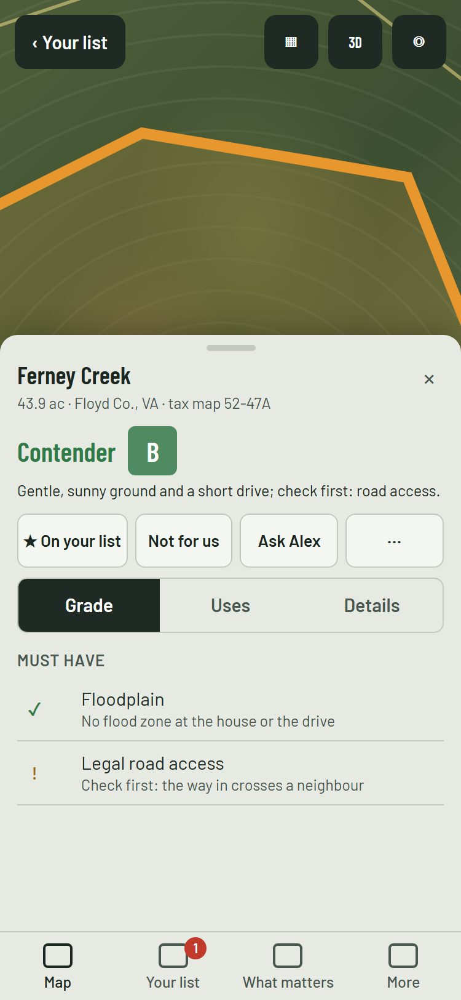
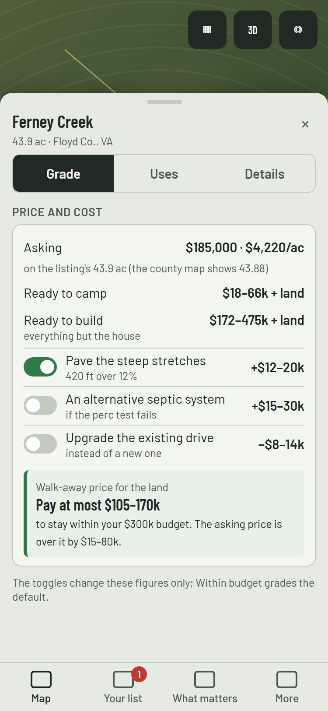
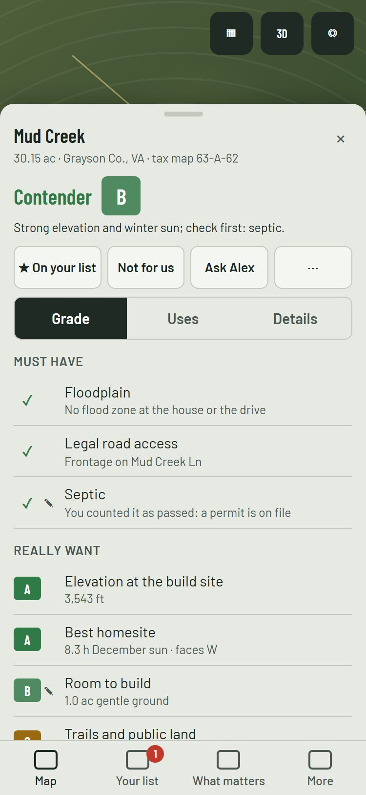
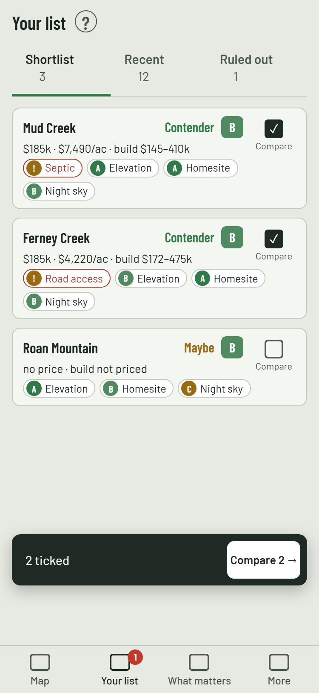
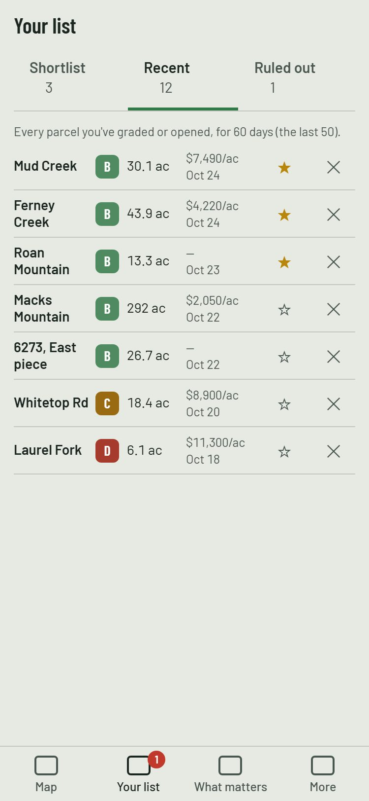

# UX audit, part 2: the redesign (mission plan)

The spec is the UX audit, `docs/design/ux-audit.md` §6, as Zach decided it (2026-10-24):
- **J-1 to J-6:** A on all six, with his notes (§6.10).
- **His friction list:** Z-1 to Z-9 (§8). His calls win where they change the proposal (§6.13).

Part 1's bug-fix PR (#308) and step 14 are on main. This plan is PR 0 into `step/ux2`. It carries:
- new 375 px mock-ups for Z-2, Z-4, Z-6, Z-7 and Z-8, in `docs/design/ux-audit/mockups-2.html` and `part2-*.jpg`;
- the market-value research (Z-5) in `docs/commercial-review.md`.

Zach has approved the direction. This plan's own new questions (§9) are answered with a recommendation, and the
mission proceeds on them, as part 1 asked. Step 15 comes after this mission and writes into Uses.

**Not in it:**
- no engine or grade change;
- no schema or storage format change beyond the Recent limits (§2);
- no new dependency.

## 1. Scope, by PR

The PRs go into `step/ux2`, each merged on green CI. The hand-back into main is Zach's to merge. A PR here starts after
[#313](https://github.com/zgrether/parcelscreen/pull/313) is on main, and the step branch takes main in first, since
#313 touches the split, the listing and the uses.

| PR | What | From |
| --- | --- | --- |
| 1 | **The names** (§4.1) on screen and in report text, each report-text rename listed for approval (§4) | P-0 |
| 2 | **Recent and closing.** Recent keeps every graded parcel (50, for 60 days). × closes and clears the map, never touching Recent. Esc closes the topmost thing only. **Not for us** (reason chips, a note) moves a parcel to **Ruled out**, greyed on the map, with Undo; Archive becomes Rule out. **One parcel panel everywhere (Z-2):** the list's own detail panel goes | P-4, P-5, Z-2, Z-3, Z-8 (limits) |
| 3 | **The parcel header and its actions** (★, Not for us, Ask, ⋯, each 44 px), with the take under the actions. The map key line. The **grading progress bar** under the header and a cleaner sheet header (Z-9). Adjust in every copy of a row's panel | P-2, Z-9 |
| 4 | **Search:** parcel numbers in every covered county, with the county named; tax-map numbers; places in the region; a pin at coordinates; the map follows | P-1 |
| 5 | **Household:** the menu item, Invite someone (a one-use link), Link a device of yours, a name at first run, Ask Alex / Ask someone | P-8 |
| 6 | **Drawing:** the map moves to the parcel, Finish in reach, and "Use it as the driveway?" at Finish | P-9 |
| 7 | **Your list:** Shortlist · Recent · Ruled out, and the compare bar. The three-line phone card with the legend behind "?" (Z-7). Recent's one-line rows (Z-8). Compare's words and its phone layout. One fixed column for marks and letters, with ✎ beside it (Z-6) | P-5, P-6, P-0, Z-6, Z-7, Z-8 |
| 8 | **What matters:** the sky in plain words, the slim Try it, whose list it is. **Double-tap zoom** on phones when no drawing tool is open (Z-1) | P-7, P-10 |
| 8b | **The price block** in Grade's Cost section (Z-4) | P-11 |
| 9 | Screenshots at 1280 and 375, the fresh-eyes review, the hand-back | |

### The mock-ups (375 px)

| Z-2: a tap opens it on the map, the one panel | Z-4: the price block | Z-6: one column for marks and letters |
| --- | --- | --- |
|  |  |  |

| Z-7: the phone's list card | Z-8: Recent, one line a row |
| --- | --- |
|  |  |

What each shows, in more detail:
- **Z-2.** A tap on a parcel anywhere (Your list, Recent, Compare, search) opens it on the map: framed (B-5's fit), with
  the standard panel. "‹ Your list" goes back to where the tap came from. The list's own detail panel (`ParcelDetail`)
  is deleted; its status actions are the header's (PR 3).
- **Z-4.** "Price and cost", in Grade:
  - the asking price and $/ac, on the listing's acres when they're entered, with both readings when they differ;
  - Ready to camp and Ready to build;
  - the optional items as toggles that change the totals live;
  - the walk-away price: the ready-to-build budget minus the build costs, as a range ("Pay at most $105–170k for the
    land to stay within your $300k budget"), with how far the asking price is over or under it.

  With no budget, there's no walk-away line. The toggles change the block's figures only (§9, Q2).
- **Z-6.** Every row view (the card, the grid, the phone strip, Compare) puts its ✓ / ! mark or letter in one 28 px
  column, with ✎ in the same fixed cell after it. The words never move.
- **Z-7.** The phone's card has three lines:
  1. the name, the verdict and the letter;
  2. price · $/ac · build cost;
  3. the person's three or four factors that matter most, as chips, with failing Musts first.

  The legend sits behind "?". The desktop keeps the full strip.
- **Z-8.** Recent has one line a row: the name (it may wrap to two lines on a phone), the letter, the acres, $/ac over
  the date, then ★ and ✕, each 44 px. A tap opens the parcel (Z-2). There are no Open on the map or Add to list buttons.

The figures in the mock-ups are illustrative where the fixtures have none (prices, toggles' amounts).

## 2. Numbers

**No engine number, grade, verdict or flag moves.** ENGINE_VERSION and the schema don't change, and no `expected.json`
changes.

The one changed constant is Recent's limits: `RECENT_MAX` and `RECENT_DAYS` in `lib/client/favorites.ts` go from 20 and 30
days to **50 and 60 days** (Z-8, Zach's numbers). They're client limits, not screen config.

The verdict text changes by J-4, Zach's decision (§4).

## 3. UX (CLAUDE.md's mission section)

- **The main flows, in the fewest steps:**
  - Open a saved parcel: one tap from anywhere (Z-2).
  - Rule one out: one tap and an optional reason (P-4).
  - Compare: tick, then the bar's button (P-5).
  - Grade: one tap, with the progress in view (Z-9).
  - Invite a partner: Household › Invite someone, then send the link (P-8).
- **What's seen first:** the answer leads every place (§6.0). The verdict comes first, then the letter (J-4). The price
  block leads with the walk-away price.
- **States:**
  - **Grading:** the progress bar, "Finding hospitals… 6 of 11", with the steps one tap away.
  - **Loading:** a pale placeholder in each loading cell, never "–" or "not screened".
  - **Empty views:** each says what fills it ("Parcels you rule out show here, with why").
  - **Errors:** each says what failed and offers Try again.
  - **A slow grade (over 60 s):** says the slow source.
- **Labels:** the one name per thing (§4.1); deleting and removing are words, and × only closes.
- **The phone at 375 px:**
  - every tap target is at least 44 px;
  - three segments of at least 110 px;
  - the header's four actions in one row;
  - Recent's row in one line;
  - the card in three lines;
  - Compare's three parcels across without a sideways swipe.
- **Contrast and consistency:**
  - the chips keep a 4.5:1 text contrast (polish: the pale Yes / Maybe chips are darkened);
  - one row style for the three list views;
  - the same controls in every copy of a panel.

## 4. Strings (CLAUDE.md rule 7)

**Interface labels** change freely, by §4.1. **Report text** (the card, One page, Full, the verdict words) changes only
as listed here. Each PR's description lists every changed string, before → after.

**The report-text renames** (Zach's J-4 and the §4.1 rows that reach the report):

| Today | After | Where |
| --- | --- | --- |
| The answer line, "{Letter} · {Verdict}" | The verdict first, then the letter: "Not for us · B, but misses a must"; "Maybe · A, held by: septic"; "Contender · B" | the card, One page, Full, the list |
| "Dealbreakers" | "Must have" | Compare (`lib/report/compare.ts`), the rulebook |
| "What money can't add" | "Really want" | Compare |
| "Still unknown", "More to check…" | "Questions for the agent" | the card's block, One page, Full, the panel |
| "Dark skies" | "Night sky" | the card's sky block, Help, the areas' words |
| "Report card", "Full report" | "Report" (the export: "Make a report"); the card stays "the card" | the panel menu, the report page, the list |
| "Warning" (Compare, the card's panel) | "Check first" | Compare, the card |

Each rename replaces a word in place, so none of them is additive. They're listed here for Zach's approval, as #300 did
for its Help correction. The goldens are regenerated in the PR that changes them, with each leaf diff named.

## 5. Facts and opinions (J-5)

A correction asks "Is this a fact about the parcel?". If it is, it becomes a shared mark: every member's grade, the
cost and the print read it. If it isn't, it stays the person's own override, as now.

**The rows that count as facts** are those a document can settle:

| Row | The fact | Its mark |
| --- | --- | --- |
| Septic | a septic permit, or a passed perc test | the Septic permit mark (exists) |
| Legal road access | a recorded right-of-way or easement | the Easement line, with "recorded in" (exists) |
| Driveway on your land | the same recorded easement | the same |
| Floodplain | an elevation certificate or a LOMA | a new "Flood letter" mark |
| Power, Internet at the road | a provider's letter or a service at the address | a new "Service confirmed" mark |
| Acres, frontage | a survey | a new "Survey" mark with its acres and frontage |

The three new marks are optional fields with defaults on the parcel (no format change), in PR 3.

**Opinions stay overrides:** every Really want and Nice to have row, how much a factor weighs, the homesite chosen, and
the night sky's and the view's readings.

## 6. Stop conditions

Push what's there, say why, and wait if:
- a change would move `expected.json`, a grade, a verdict or flag text beyond §4;
- a product decision is needed that §9 doesn't answer;
- the same CI failure survives three attempts;
- this plan turns out wrong (a flow can't be built as mocked without losing something on the list).

## 7. Test plan outline

- **Unit tests:**
  - the Recent limits (50, 60 days);
  - × never removes from Recent;
  - Rule out, and Move back;
  - Esc's topmost rule;
  - the walk-away price (a budget, none, toggles);
  - J-4's answer line for each verdict;
  - the fact-or-opinion question and the shared mark it makes;
  - parcel-number search in every county, with tax-map numbers;
  - the double-tap gate (on unless a drawing tool is open).
- **e2e:**
  - opening from each place moves the map and shows the one panel;
  - Not for us, then Undo;
  - Recent's row actions;
  - the grading progress bar on a phone;
  - Household's invite link joins a new member (in-memory sync store);
  - drawing a track, then "Use it as the driveway?";
  - the price block's toggles.
- **Screenshots** at 1280 and 375 of every changed screen, and the fresh-eyes review, in the hand-back.
- **The hand-back's manual test plan:** 20–30 minutes on the preview, desktop then phone, with Mud Creek, Macks, Ferney
  and Roan.

## 8. Order and timing

PR 1 starts once #313 is on main. Each PR is small enough to review in ten minutes; PR 2 and PR 7 are the largest and
may split (2a / 2b, 7a / 7b).

## 9. Questions, each answered with a recommendation (the mission proceeds on these)

1. **Where "‹ Your list" goes back to (Z-2):** the view and the scroll the tap came from. *Recommended.*
2. **The price block's toggles and the grade (Z-4):** the toggles change the block's figures only; Within budget grades
   the default, as §8 recommended. *Recommended*, so a grade never depends on a switch left on.
3. **Which toggles (Z-4):** the cost's optional items that exist today:
   - paving the steep stretches (over 12% by default, Settings › Costs);
   - an alternative septic system instead of a conventional one;
   - upgrading an existing drive instead of building a new one.

   No new cost item comes in this mission.
4. **Recent's age (Z-8):** 60 days from the last time it was opened or graded, not from when it was first seen.
5. **Ruled out's reasons:** the chips are Too steep, Road access, Septic, Price, Too far and Other, with an optional
   note. A reason is shown on the row and kept with the parcel (an optional field).
6. **The new fact marks (§5):** they come in PR 3, with the correction's question. If they need more than optional fields
   on the parcel, that's a stop condition.
7. **The phone card's chips (Z-7):** the top four factors by the person's own order (Must have first, failing ones
   first), the letter or mark in the chip.

## 10. Market value (Z-5)

The research is in `docs/commercial-review.md`, under "Market value references". Zach decides later whether the app
shows one. Nothing in this mission uses it.

## 11. Decision

Zach approved the direction and its six calls (2026-10-24). This plan is PR 0, merged into `step/ux2` on green; the
mission proceeds on §9's recommendations unless Zach says otherwise on this PR.
