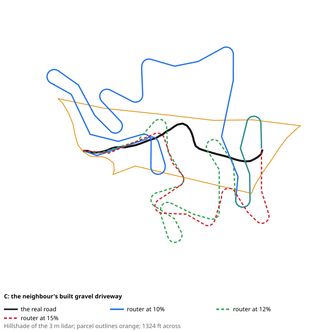
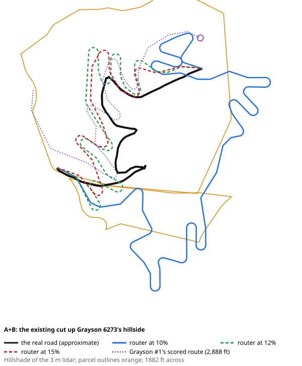

# Driveway validation against real roads

Generated by `pnpm dw:val` (`test/tools/driveway-validation.test.ts`), live against the public services. Report only: no engine change. The owner's request (2026-10-11): check the router and the cost model against a built road on the hillside beside Grayson 6273.

## 1. The roads

- **C: the neighbour's built gravel driveway**: Digitized from NC OneMap orthoimagery (Orthoimagery_Latest), checked against the USGS 3DEP 1 m lidar hillshade. From the gate where Mud Creek Rd bends to the cleared pad by the buildings. Then snapped onto the road bench in the lidar (the flattest ground within 8 m across, kept continuous). Start 36.58331, -81.56283, end 36.58333, -81.56027.
- **A+B: the existing cut up Grayson 6273's hillside** (approximate): Digitized from the USGS 3DEP 1 m lidar hillshade only (NC's orthoimagery stops at the state line). Approximate: the owner reads it as the route to the top of 6273; its straight middle stretch is the least certain. Snapped onto the bench the same way. Snapped onto the bench the same way. Start 36.58408, -81.56345, end 36.58580, -81.56037.

Neither is mapped in OpenStreetMap (checked 2026-10-11). The lidar and soils are the screen's own: a rectangle (36.5822–36.5868, -81.565–-81.5595) screened at 3.0 m, so the slope, soils, bedrock depth and drainage are what the engine reads.

## 2. Measured on the lidar, against the router between the same ends

Grades are the ground's under each line, between the cells, as the card reads them. Switchbacks are counted on each line the same way: a heading change of 100° or more over 30 m. The router's own landing count is in brackets.

### C: the neighbour's built gravel driveway

| Line | Length (ft) | Rise (ft) | Max grade over 15 / 30 / 60 m (%) | Average over 15 / 30 / 60 m (%) | Switchbacks | Length over 10 / 12 / 15% (30 m) | Cost (engine's model) |
|---|---|---|---|---|---|---|---|
| **The real road** | 872 | 173 (178 climbed) | 47.4 / 41.0 / 33.0 | 20.9 / 20.2 / 19.9 | 1 | 69% / 66% / 65% | $58k ($67/ft) |
| Router at 10% (shortest legal; 11 landings) | 3,925 | 173 (234 climbed) | 19.5 / 13.2 / 11.2 | 6.8 / 5.7 / 5.1 | 11 | 3% / 1% / 0% | $210k ($53/ft) |
| Router at 12% (shortest legal; 9 landings) | 2,786 | 173 (205 climbed) | 20.4 / 12.0 / 11.8 | 7.9 / 7.3 / 6.8 | 9 | 26% / 0% / 0% | $132k ($47/ft) |
| Router at 15% (shortest legal; 6 landings) | 1,720 | 168 (178 climbed) | 22.1 / 16.0 / 14.3 | 10.7 / 9.8 / 9.6 | 4 | 59% / 41% / 2% | $100k ($58/ft) |

### A+B: the existing cut up Grayson 6273's hillside

| Line | Length (ft) | Rise (ft) | Max grade over 15 / 30 / 60 m (%) | Average over 15 / 30 / 60 m (%) | Switchbacks | Length over 10 / 12 / 15% (30 m) | Cost (engine's model) |
|---|---|---|---|---|---|---|---|
| **The real road** | 2,290 | 296 (340 climbed) | 48.4 / 34.5 / 26.6 | 15.8 / 14.7 / 13.6 | 5 | 76% / 69% / 48% | $102k ($45/ft) |
| Router at 10% (shortest legal; 18 landings) | 5,743 | 296 (360 climbed) | 17.2 / 12.1 / 10.0 | 6.9 / 6.2 / 6.0 | 17 | 3% / 0% / 0% | $282k ($49/ft) |
| Router at 12% (shortest legal; 10 landings) | 3,619 | 297 (318 climbed) | 20.5 / 15.2 / 11.8 | 9.0 / 8.4 / 8.2 | 10 | 42% / 1% / 1% | $287k ($79/ft) |
| Router at 15% (shortest legal; 6 landings) | 2,608 | 297 (303 climbed) | 22.3 / 18.3 / 14.7 | 11.7 / 11.4 / 11.4 | 6 | 70% / 52% / 7% | $162k ($62/ft) |

## 3. Drawings

## 4. The real roads priced with the engine's quantity model

Today's unit rates (Settings), the corrected quantities (#100); a real road's switchbacks are in its per-sample cut, so no landing benches are added.

| Road | Length (ft) | Fixed (mobilise, entrance, erosion) | Clearing | Earthwork, soil | Earthwork, rock | Stone | Fabric | Culverts | Relief culverts | Total | Per ft |
|---|---|---|---|---|---|---|---|---|---|---|---|
| C: the neighbour's built gravel driveway | 872 | $15k | $3k | $6k | $0k | $10k | $0k | $7k | $18k | **$58k** | $67/ft |
| A+B: the existing cut up Grayson 6273's hillside | 2,290 | $15k | $8k | $7k | $1k | $27k | $0k | $4k | $42k | **$102k** | $45/ft |

**The replica against the engine,** on the router's own routes (the replica plus the engine's landing benches):

| Route | Engine | Replica | Difference |
|---|---|---|---|
| C at 10% | $210k | $217k (of which landings $68k) | 3.3% |
| C at 12% | $132k | $136k (of which landings $27k) | 2.6% |
| C at 15% | $100k | $104k (of which landings $23k) | 3.5% |
| A+B at 10% | $282k | $293k (of which landings $95k) | 3.7% |
| A+B at 12% | $287k | $287k (of which landings $156k) | 0.0% |
| A+B at 15% | $162k | $162k (of which landings $56k) | -0.0% |

## 5. The neighbour parcel, screened

The neighbour parcel, Ashe County NC (the owner's 4.90 ac screen), PINs 082044716014 + 082044800946: 4.9 ac, verdict marginal. Sites: #1 0.19 ac, score 71, 811 ft of driveway; #2 0.31 ac, score 67, 204 ft of driveway.

The screen's site #1 is 618 ft from the end of C (the pad), and its driveway comes from E1 (road), 205 ft from the pad, not up C from Mud Creek Rd: the Census roads include one at the top of this parcel. The card as it reads:

> Entrance candidates on the frontage (E1 best): E1 road — road 4%, bend 2°, bank 0 ft; E2 Mud Creek Rd — road 3%, bend 22°, bank 10 ft; E3 Mud Creek Rd — road 3%, bend 13°, bank 14 ft.
>
> **Recommended — shortest legal** from E2 · $37–69k
> - Length / rise: 811 ft / 65 ft
> - Grade over 30 m / average: 16.2% / 9.5% (limit 15%)
> - Switchbacks: 2
> - Earthwork: 1,007 yd³
> - Stone: 248 tons (12 ft × 6 in)
> - Clearing corridor: 0.45 ac
> - Culverts: 1 (entrance + 0 drainage crossings)
> - Relief culverts: 3 (one every 150–400 ft, by grade)
> - Paving (over 12%): ~325 ft (cost TBD)
>
> **Alternative — shortest legal — needs an easement** from E1 · $63–117k
> - Length / rise: 1,650 ft / 145 ft
> - Grade over 30 m / average: 14.9% / 11.3% (limit 15%)
> - Switchbacks: 5
> - Earthwork: 1,903 yd³
> - Stone: 505 tons (12 ft × 6 in)
> - Clearing corridor: 0.91 ac
> - Culverts: 1 (entrance + 0 drainage crossings)
> - Relief culverts: 7 (one every 150–400 ft, by grade)
> - Paving (over 12%): ~1,014 ft (cost TBD)
> - Leaves the boundary:  **295 ft outside the line — needs an easement**
>

## 6. Conclusions

**Caveats first.** Every grade here is the bare ground under the line on the 3 m lidar, as the card reads it: a built road's own grade reads about 1–4 points lower once cut and fill smooth it (the card's note; follow-up 48). The lidar's date against the roads' is unknown, though both cuts show in it as benches. C was traced from the orthophoto and A+B from the lidar alone, then both snapped onto their bench; a few metres of error across a 30° slope moves a 15 m grade a lot, so the 30 and 60 m windows are the ones to read.

**What grade local practice builds here.** Far steeper than our 10% default.
- C, the neighbour's built drive, climbs 173 ft in 872 ft: 20.2% on average over 30 m, 33.0% at its steepest over 60 m, with 65% of its length over 15%. That's set by its two ends (the gate and the pad), not by the trace. You know it as gravel; in the orthophoto its steepest stretches read dark, like asphalt or chip seal, which is worth a look on the visit.
- A+B, the older cut up 6273, averages 14.7% over 30 m with 48% of its length over 15%.
- **Both would fail our own 20% veto,** read the way the veto reads it (ground over 30 m): C at 41.0%, A+B at 34.5%. Even allowing the 1–4 point ground-vs-road gap, C's steepest stretches are over 20%.
- **Reading:** on this hillside, roads are built at 15–20% with short steeper pitches, not 10%. A 10% limit is a comfort target (and a sensible one for a long gravel drive), not a description of what gets built.

**Does the router's alignment look like the real road?** No, not at 10–12%.
- C: the real road has 1 switchback in 872 ft. The router at 10% needs 3,925 ft and 11 landings; at 12% 2,786 ft and 9; at 15% 1,720 ft and 6. The drawing shows why: under a hard cap the router builds ladders of short legs, where the real road takes one sweeping hairpin and climbs the pitches directly.
- A+B is closer at 15%: 2,608 ft with 6 landings, against the real road's 2,290 ft and 5 switchbacks (legs of 187, 59, 285, 463 ft). At 10% it's 5,743 ft with 18 landings.
- **Reading:** at 15% the router resembles the old access road; at 10% it builds a road neither of these is.

**Is the cost model plausible?** Per foot, yes; in total, only when the alignment is.
- Priced with the engine's model, C comes to $58k ($67/ft) and A+B to $102k ($45/ft). The router's routes run at a similar $45–80/ft; their totals (up to $287k) come from their length, not the rates.
- Two things look high. Relief culverts are 30% of C's price: at its grades the rule asks for one every 150 ft, at the full culvert rate. Your quote's relief-pipe rate (`dw.reliefCulvertEach`) will tell. And the router's landings: 54% of A+B's 12% route ($156k for 10 landings) and 32% of C's 10% route. A graded bench up to 3 m deep across the full 12 ft on a steep side slope prices each switchback at $3–16k; the real roads' hairpins are in their ordinary cut.
- Not priced at all: paving. If C's steep stretches are surfaced, its real cost is above this.

**Constants the comparison suggests changing** (proposals for you; nothing changed here):
1. **The grade limit default: 10% → 15%** for screening this terrain, keeping 10% as an option. The over-limit term and the "no practical drive" rule then start from what's actually built.
2. **Short steep pitches:** let a route exceed its limit for a short stretch (e.g. up to limit + 5 for at most 30 m) at a cost, rather than forbidding it. C's shape (one hairpin, a few steep pitches) is out of the router's reach today: its pitches are over the 20% veto, let alone a 10–15% cap.
3. **Landings: fewer and cheaper.** Raise the landing's search cost (30 m now) so a ladder of short legs loses to a longer, steadier line, and price a landing as a half bench like the ordinary road rather than a full-width cut or fill up to 3 m. A+B has legs as short as 59 ft (an S-curve), so the 100 ft minimum leg is not the constraint; the number of landings is.
4. **The veto at 20% on ground grade** would reject the neighbour's real drive. Either read it on the road's grade (follow-up 48) or raise it to about 25% until then.
5. **Relief culverts:** keep the count, but price them with the quote's small-pipe rate.

## 7. At the new defaults (15% limit, 25% veto; engine 13)

The router is unchanged, so its routes at the default are the 15% rows above; what changed is the default, the veto, and that every card now shows its length over the paving grade.

| Road | The real road | The router at 15% | Landings' share of its cost | The real road's steepest 30 m, at the 25% veto |
|---|---|---|---|---|
| C | 872 ft, 1 switchback, ~650 ft over 12% | 1,720 ft, 6 landings, ~1,102 ft over 12%, $100k | 23% | 41.0% (vetoed) |
| A+B | 2,290 ft, 5 switchbacks, ~1,919 ft over 12% | 2,608 ft, 6 landings, ~2,047 ft over 12%, $162k | 35% | 34.5% (vetoed) |

- **Ladders:** yes, still: C's route at 15% has 6 landings where the real road has 1 switchback. On A+B the router is close (6 landings against 5 switchbacks).
- **Landing share:** 23% of C's route and 35% of A+B's, both under the owner's ~40% threshold.
- **The veto:** both real roads still exceed 25% over 30 m on the ground (C 41.0%, A+B 34.5%); the gap between ground and road grade is follow-up 48's.
- **The owner's rule** (#103 decisions): the router still builds ladders, so landing and pitch changes are proposed as a follow-up (in the PR).

## 8. Drift test on C's steepest stretch (owner, 2026-10-15)

Written by hand, not by `pnpm dw:val` (which keeps this section when it rewrites the file). The tables below come from `pnpm study:drift grayson-mud-creek-6273 c` (test/tools/drift-study.test.ts), which writes the same test for any fixture and line: `pnpm study:drift <fixture> <line>`, where the line is a road in `driveway-validation.roads.json` or a GeoJSON LineString file, and the report goes to `tmp/study-drift/`. It's the basis for snapping a drawn drive onto its roadbed (phase-0.md follow-up 57). The question: is C's 41% over 30 m the drive, or the hand-drawn line drifting off the roadbed onto the slope beside it? Measured offline on the Grayson fixture's 3 m lidar (cells 3.0 m, the screen's own), along the trace in `driveway-validation.roads.json`. Distances are from the gate.

**The trace there.** Its 30 m grade is over 25% from 325 to 463 ft, peaking at 40.8% at 374 ft.
- **The ground across the line**, over ±2 m, falls 30–51% sideways from 335 to 425 ft. A flat strip (5% or less across) lies 4–8 m to the right of the trace from 385 ft on, and 3–5 m to the left before 345 ft.
- **The trace turns about 100° between 413 and 512 ft**: the hairpin §2 counts. It comes right after the steep pitch, and the flat strip is on its inside.
- **Along the whole trace,** the ground falls more than 20% sideways for 758 of its 872 ft (39% on average). The 3 m lidar barely resolves a 12 ft roadbed, so this finds the bench only where it's wide. It doesn't mean the trace misses the road everywhere.

**The line shifted sideways.** The whole trace was moved perpendicular to itself; plus is left of the line, travelling from the gate.

| Shift | Steepest 30 m | Length over 25% |
|---|---|---|
| −6 m | 37.7% | 374 ft |
| −4 m | 37.9% | 423 ft |
| −2 m | 38.7% | 433 ft |
| 0 (the trace) | 40.8% | 423 ft |
| +2 m | 42.0% | 413 ft |
| +4 m | 41.4% | 423 ft |
| +6 m | 39.4% | 374 ft |

**The best-fitting line.** At every 3 m, the middle of the flattest 4 m band across, smoothed over 15 m. It sits on the flat strip from 385 ft on (1–5% across), but has to cross the slope where the strip changes sides, at 345–385 ft.

| Fit | Steepest 30 m | Over 25% in one run | Over 25% in all | Over 30% in all |
|---|---|---|---|---|
| band within ±10 m | 39.5% | 98 ft | 394 ft | 187 ft |
| within ±10 m, held near the trace | 39.3% | 89 ft | 404 ft | 197 ft |
| band within ±6 m | 40.1% | 138 ft | 364 ft | 207 ft |

**Answers.**
- **Does the line sit on the roadbed there?** Not from 335 to 425 ft. It runs on a 30–50% side slope, with a flat strip a few metres to one side. **But drift isn't what makes it steep.** On that strip, or shifted either way, the steepest 30 m stays at 38–42%.
- **The steepest 30 m grade to trust: about 38%,** give or take 2 points (the lowest honest fit). Not the teens, and not under 25%.
- **Over 25%:** one pitch of about 90–140 ft, just below the hairpin; about 360–420 ft in all along the drive. Over 30%: about 190–210 ft.
- **Why it can't come down much:** C's 20% average is set by its two ends, a 173 ft climb from the gate to the pad over the trace's 872 ft. A line on the bed can only read lower if the real drive is longer than the trace.
- **What would lower it, and what to look at in person:**
  - **The hairpin swings wider than the trace,** making the drive longer through the bend. Hillshade at full zoom would show it.
  - **The lidar predates a regrade.**
  - **Or it really is that steep.** §1 noted that C's steepest stretches look dark in the orthophoto, as if paved. A 35–40% pitch would need that. A phone inclinometer on the pitch just below the hairpin settles it.
- **For the app:** this is the case for snapping a drawn drive onto the roadbed the lidar shows (owner, 2026-10-15: kept for later). Here it would tidy the line, not the grade.
